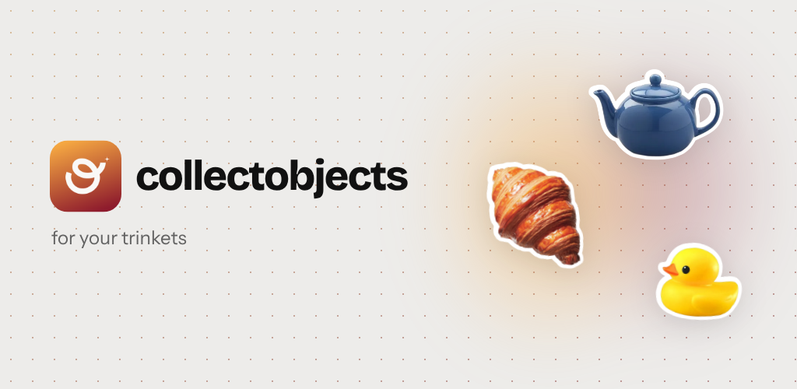
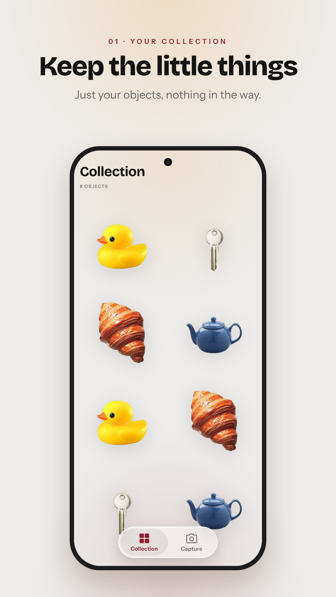
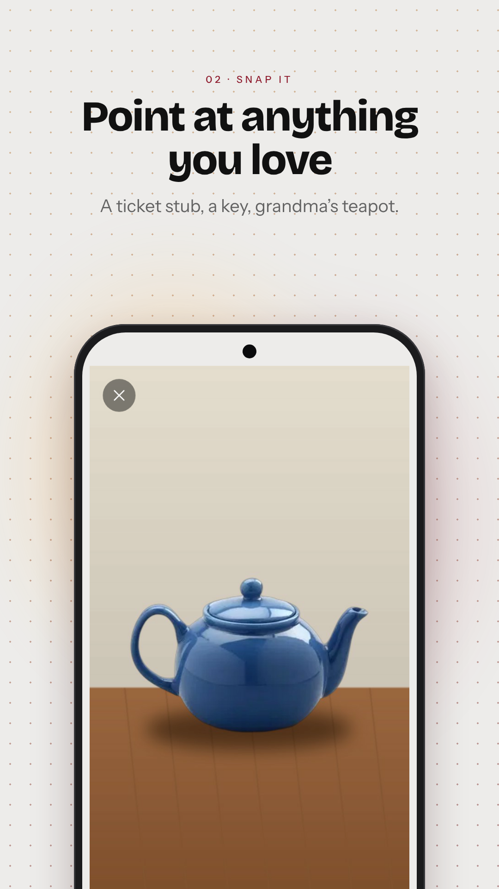
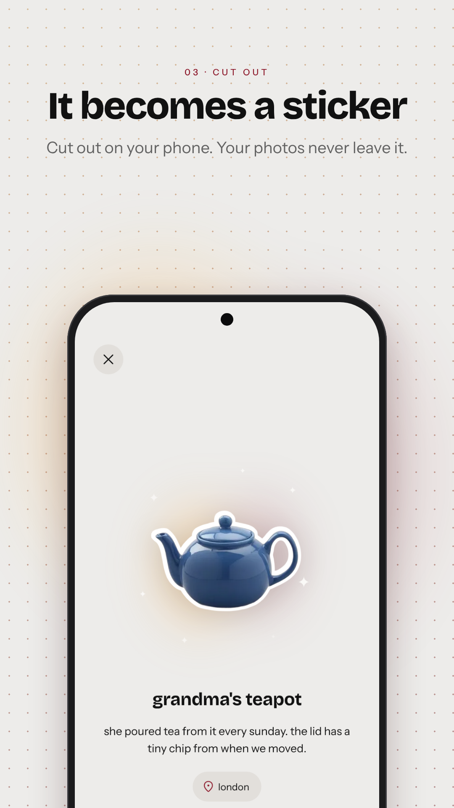
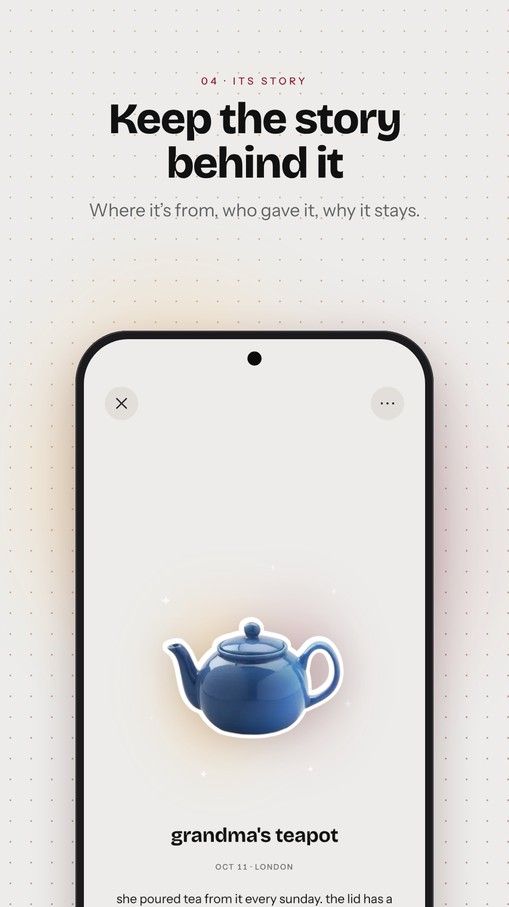
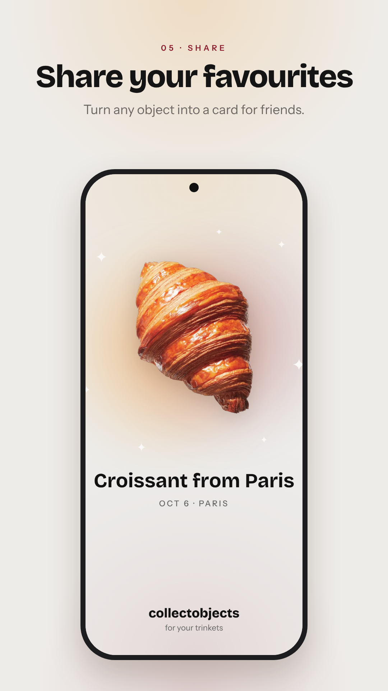

# collectobjects — for your trinkets

*Made by Vidhi*



**A little home for your trinkets and keepsakes.** Snap something you love, it's cut out on your phone, and it keeps the story behind it: where it's from, who gave it to you, why it stays.

## Try it
- **Live web preview:** **https://collectobjects.vercel.app**
- **Android app (the full experience):** download the APK from the [**latest release**](../../releases/latest) on an Android phone and open it to install.

> **Why the web preview isn't the full experience.** The heart of the app, cutting your object out of the photo, runs **on the phone** with **Google ML Kit Subject Segmentation**, an on-device machine-learning model that ships with Google Play services. It finds the main object in the photo and returns a soft-edged mask, so the cut-out looks clean and **your photo never leaves the phone**. Browsers can't use that Android model, so on the web a photo is kept whole. "Add city" (Android's geocoder), haptics and the native share sheet are Android-only too. The web preview is there to show the design and the flow; install the APK to see the cut-out.

## Screens

| Your collection | Snap it | Cut out | Its story | Share |
|---|---|---|---|---|
|  |  |  |  |  |

## Product updates

### Now (v1, Android)
- **Snap or pick a photo.** The object is cut out on the device (ML Kit Subject Segmentation) and lifts off the page with a soft glow, sparkles and a haptic tap.
- **Name it and keep its story,** with an optional city (approximate location, city name only).
- **Your collection,** newest first, with a close-up that tilts with the phone and catches the light.
- **Share cards:** one object, or your whole collection as a numbered "starter pack", story-sized for Instagram and friends.
- **Little touches:** a time-of-day greeting, toasts with icons, a quiet ⋯ menu for delete.
- **Private by design:** no account, no ads, no tracking. Photos and stories are stored only on the device.
- **Play Store ready:** icon, store listing, screenshots, privacy policy and Data safety answers in [`store/`](store).

### Next
- **iPhone app:** native SwiftUI with Liquid Glass, cut-outs with **Apple's Vision framework** (`VNGenerateForegroundInstanceMaskRequest`, on-device, the same lift-the-subject tech as the Photos app), and **3D scans** of objects with Object Capture on LiDAR iPhones.
- Play Store launch (closed testing, then production).
- Backup and export, gallery photos keeping their original date, and "on this day" memories.

## Design
I designed and built this end to end, from research to a Play-Store-ready Android app.
- **Research:** a teardown of similar apps (Trinket, Kept, Museeum, Loot, CapWords) and what to learn from each: [`design/research/competitors.md`](design/research/competitors.md).
- **Design system:** colour, type (Bricolage Grotesque + Instrument Sans), components, motion and voice, documented in [`design.md`](design.md) and [`design/`](design), with tokens in [`design/tokens.json`](design/tokens.json). It moved from a CapWords-like look to its own: a neutral app with an orange-to-maroon hue in a few chosen places.
- **Brand:** the "c into o" mark, app icon and store graphics: [`assets/logo/`](assets/logo), [`store/`](store).
- **Content:** every word in the app lives in one file, [`js/copy.js`](js/copy.js) (mirrors [`design/content.md`](design/content.md)).
- **How it evolved,** review by review: [`CHANGELOG.md`](CHANGELOG.md).

## Built with
Web UI (HTML, CSS, JavaScript modules) packaged as a native Android app with **Capacitor**. Native Java plugins for the on-device cut-out (**ML Kit Subject Segmentation**), dialogs and city lookup. Web preview on **Vercel**; Android builds on **GitHub Actions**.

---

*Made by Vidhi* · [github.com/vidhidoshi09](https://github.com/vidhidoshi09)

---

## For developers

It runs as a web app (`index.html`), and Capacitor packages the same app as an Android app (`android/`). Vercel builds it with `npm run build` (see `vercel.json`). Design system: [`design.md`](design.md).

## Run locally

```bash
npm install
npm start   # serves the app at http://localhost:8000 and reloads on save
```

### Live reload on the Android emulator
Start the emulator, then run these in two terminals:

```bash
npm start            # terminal 1: local server
npm run dev:android  # terminal 2: installs the app pointed at the local server
```

Saving `index.html` or a file in `css/` or `js/` now refreshes the app on the emulator. Press Ctrl+C in terminal 2 when done, then run `npm run sync` before building a normal APK.

## Android app

### Get an APK without installing anything
The easiest way: download `collectobjects-vX.Y.Z.apk` from the [**latest release**](../../releases/latest) on your phone and open it. To install it, allow "Install unknown apps" for your browser or file manager.

Each push also runs the **Android APK** GitHub Action: open the run under the repo's **Actions** tab, download the `collectobjects-debug-apk` artifact, unzip it, and install `app-debug.apk`.

**Publish a new release:** bump `versionName` (and `versionCode`) in `android/app/build.gradle`, then push a matching tag, e.g. `git tag v1.0.1 && git push origin v1.0.1`. The Action builds the APK and publishes the release with it attached.

### Build locally
Requirements: Node 20+, JDK 21, Android Studio (with the Android SDK).

```bash
npm install
npm run sync          # copy the web app (index.html, css/, js/, assets/) into the Android project
npm run open:android  # open in Android Studio, then press Run
# or build the APK from the command line:
npm run apk           # -> android/app/build/outputs/apk/debug/app-debug.apk
```

After editing `index.html`, `css/`, `js/` or `assets/`, run `npm run sync` again so the Android project picks up the change.

### Release build for the Play Store
1. Create an upload key once (keep it and its passwords safe, outside git):
   `keytool -genkeypair -v -keystore ~/collectobjects-upload.jks -keyalg RSA -keysize 2048 -validity 10000 -alias upload`
2. Create `android/keystore.properties` (git-ignored):
   ```
   storeFile=/Users/<you>/collectobjects-upload.jks
   storePassword=...
   keyAlias=upload
   keyPassword=...
   ```
3. `npm run release` → `android/app/build/outputs/bundle/release/app-release.aab`, which you upload to Play Console.
4. Bump `versionCode` (and `versionName`) in `android/app/build.gradle` for every upload.

Store listing text, privacy policy, Data safety answers and graphics are in `store/`.

### Notes
- App ID: `com.vidhidoshi.collectobjects` (set in `capacitor.config.json`).
- The camera uses the `CAMERA` permission. Android asks for it the first time you tap **+**.
- The hardware back button closes the open screen. On the grid, it exits the app.
- Objects are saved as files in the app's private storage on the device (`objects.json` plus `objects/`). Each record is `{ id, no, name, date, file, note? }`; `no` is the permanent exhibit number. Uninstalling the app deletes them.
- Data from earlier versions moves in by itself on first launch: `memories.json` + `photos/` (before the rename) and base64 images in localStorage (the first versions). Objects saved without a number are numbered once, oldest first.
- Haptics (`@capacitor/haptics`): a light tap when a new cut-out lifts off the page, a success buzz when it lands in the grid.
- Background removal runs on the device with Google ML Kit (`BackgroundRemoverPlugin.java`); no API key or internet service. The model is a Google Play services module: Play Store installs download it with the app, otherwise it downloads on first use. In a desktop browser (`npm start`) the photo is kept as is.

## Project structure

- `index.html`: markup and the inline icon sprite; loads `vendor/native.js`, then `js/main.js`.
- `css/app.css`: all styles; tokens follow `design/tokens.json` (design system: `design.md`).
- `js/`: the app as ES modules.
  - `main.js`: event wiring, Android back button, startup.
  - `copy.js`: every user-facing string; rename the app by changing its constants.
  - `platform.js`: Capacitor and plugins (App, Filesystem, Haptics, BackgroundRemover, NativeUi) from `window.Native`.
  - `state.js`: shared mutable state (objects, camera stream, pending photo, just-saved id).
  - `storage.js`: files on the device, exhibit numbers, migrations, photo URLs.
  - `grid.js`: grid, detail view, editing, delete.
  - `camera.js`: camera, capture, gallery import, the capture flow.
  - `background.js`: background removal and the progress ring.
  - `review.js`: review (the reveal) and save.
  - `tilt.js`: holographic tilt of the detail cut-out.
  - `motion.js`, `haptics.js`: restart CSS animations, reduce-motion check; the two haptic moments.
  - `overlays.js`, `format.js`: overlay show/hide, date and HTML helpers.
  - `snackbar.js`, `textfield.js`: snackbar messages, the growing story field.
- `src/native.js`: source of `vendor/native.js` (bundled by `npm run vendor`).
- `assets/`: images and fonts (Bricolage Grotesque, Instrument Sans; OFL). `android/`: the Capacitor Android project. `www/`: build output.
